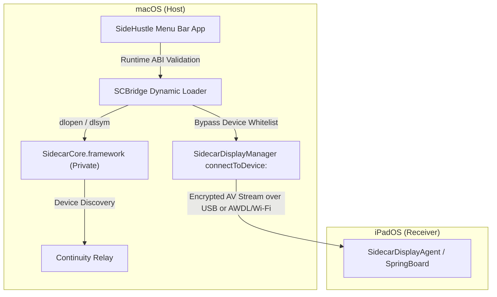

# SideHustle

> **Use native Sidecar on unsupported iPads without disabling SIP, patching system files, or installing iPad apps.**

---

## Executive Summary

**SideHustle** is an open-source macOS utility that brings Apple’s native **Sidecar** (display extension and mirroring) to iPad models excluded from Apple's official compatibility list. 

By dynamically loading private macOS Sidecar frameworks and bypassing UI-level device-eligibility filters, SideHustle initiates official Sidecar display sessions with older hardware running iPadOS 13+.

---

## Key Highlights

* **No Jailbreak Required**: Runs entirely on stock iPadOS.
* **Zero System Patches**: No modifications to macOS system files; System Integrity Protection (**SIP**) remains enabled.
* **True Native Display**: Uses Apple's built-in Sidecar display engine—standard macOS Display Settings, gestures, and window controls work out of the box.
* **Persistent Sessions**: Once connected, SideHustle can be closed without interrupting the running display session.

---

## How It Works

Apple restricts Sidecar on older devices primarily at the UI and policy layer in macOS, rather than inside the low-level streaming engine. SideHustle interfaces directly with macOS private frameworks to orchestrate the connection.



### Core Architecture Stages

1. **Dynamic Runtime Binding (`SCNativeBackend`)**
   * Uses `dlopen` and `dlsym` at runtime to bind to `/System/Library/PrivateFrameworks/SidecarCore.framework`.
   * Dynamically resolves private classes (`SidecarService`, `SidecarDisplayManager`, `SidecarDevice`) and functions.
2. **Strict ABI & Method Signature Validation**
   * Before executing private selectors, SideHustle compares runtime Objective-C method type encodings against expected signatures (e.g. `connectToDevice:completion:`, `connectedDevices`).
   * Prevents system crashes or undefined behavior across different macOS updates.
3. **Targeted Model Allowlisting (`SCAllowPeer`)**
   * macOS flags older iPads as ineligible via `SidecarDisplayIsSupportedReceivingDevice`.
   * SideHustle intercepts discovered peers and selectively enables explicit device identifiers capable of iPadOS 13:
     * **iPad mini 4**: `iPad5,1`, `iPad5,2`
     * **iPad Air 2**: `iPad5,3`, `iPad5,4`
     * **iPad (5th Gen)**: `iPad6,11`, `iPad6,12`
4. **Session Hand-off (`SCSession`)**
   * Invokes `[SidecarDisplayManager connectToDevice:completion:]`.
   * Once Apple's native daemons take over encoding and transport, the display becomes managed natively by macOS WindowServer.

---

## Protocols & Underlying Technologies

| Domain | Protocol / Technology | Technical Description |
| :--- | :--- | :--- |
| **Authentication & Trust** | **Apple Account / 2FA & Pairing Keys** | Requires both devices to be logged into the same Apple Account with 2FA enabled. USB connections require mutual device trust pairing records. |
| **Physical Transport** | **USB (`usbmuxd`) & AWDL / 802.11ac** | Connects over physical Lightning/USB cables via Apple's USB multiplexing daemon, or wirelessly over Apple Wireless Direct Link (AWDL). |
| **Device Discovery** | **Apple Continuity / BLE / Bonjour** | Utilizes Bluetooth Low Energy (BLE) proximity beacons and mDNS/Bonjour discovery handled by `SidecarService` and identity daemons (`sharingd`). |
| **Media & Video Streaming** | **Hardware H.264 / HEVC over AVStream / RTP** | Video is hardware-encoded using VideoToolbox on the Mac and decoded by the iPad's display receiver daemon (`SidecarDisplayAgent`). |
| **App Architecture** | **Objective-C Runtime & ServiceManagement** | Built in lightweight Objective-C; uses `SMAppService` for login-item management and `NSStatusBar` for menu bar integration. |

---

## Compatibility Matrix

| Category | Supported Configurations |
| :--- | :--- |
| **Tested iPad** | **iPad (5th generation)** Wi-Fi (`iPad6,11`) on iPadOS 16.7.16 |
| **Experimental iPads** | iPad Air 2 (`iPad5,3`, `iPad5,4`), iPad mini 4 (`iPad5,1`, `iPad5,2`), iPad 5 Cellular (`iPad6,12`) |
| **Mac Requirements** | **Apple silicon (M1/M2/M3/M4)** running **macOS 13 Ventura or later** |
| **Unsupported** | Intel-based Macs; iPads incapable of running iPadOS 13 or earlier |

---

## Build & Installation

### Requirements
* Mac with Apple silicon
* macOS 13.0 or later
* Xcode Command Line Tools (`xcode-select --install`)

### Building from Source

```bash
# Clone the repository
git clone https://github.com/nixboi42/SideHustle.git
cd SideHustle

# Compile the binary with ad-hoc signing
bash scripts/build.sh

# Install into ~/Applications
bash scripts/install.sh
```

---

## Usage Instructions

1. **Verify Account**: Ensure your Mac and iPad are signed into the **same Apple ID** with **Two-Factor Authentication** enabled.
2. **Connect & Trust**: Connect your iPad via USB or ensure Wi-Fi and Bluetooth are enabled on both devices. If using USB, unlock your iPad and tap **Trust This Computer**.
3. **Launch SideHustle**: Open `SideHustle.app` from `~/Applications`.
4. **Connect**: Select your iPad from the dropdown menu and click **Connect**.
5. **Manage Display**: Arrange displays or change scaling under **System Settings → Displays**.

---

## Source Code Layout

* `Sources/SCBridge.h` / `Sources/SCBridge.m`: Dynamic loader for `SidecarCore`, ABI verification engine, device allowlist filter, and connection controller.
* `Sources/main.m`: Native macOS menu bar UI, auto-connect timers, and login item integration.
* `docs/COMPATIBILITY.md`: Detailed hardware validation reports.
* `scripts/`: Shell scripts for compiling, testing, and packaging the application bundle.

---

## License & Disclaimers

* **License**: MIT License.
* **Disclaimer**: This project is not affiliated with, endorsed by, or sponsored by Apple Inc. Sidecar, iPadOS, and macOS are registered trademarks of Apple Inc. Apple private frameworks are bundled with macOS and are not redistributed with this project.
